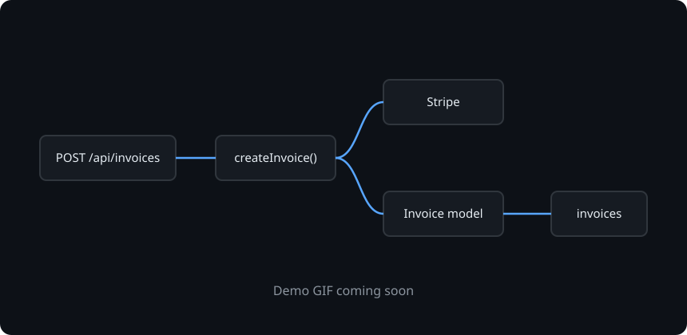
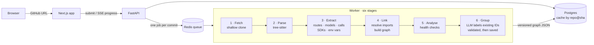

<div align="center">

# Evident

### Architecture maps you can verify.

**Paste a GitHub URL. Get an interactive map of every route, database table and external service in a Next.js, Express and Prisma app, and how they connect.
Every box and every arrow links to the exact line of code that proves it.**

[](https://github.com/aadilsal/Evident/actions/workflows/ci.yml)
[](LICENSE)


[**Live demo**](#) · [**Benchmarks**](#accuracy-measured-not-promised) · [**How it works**](#how-it-works) · [**Docs**](docs/)

<!-- Swap for docs/assets/demo.gif: paste URL → map renders → click a route → request path lights up → evidence panel opens. -->


</div>

---

## The problem

You join a new codebase, or you're about to review a pull request in a project you don't know. The first question is always the same: **what talks to what?**

Which routes write to the `User` table? What breaks if I change `Invoice`? Where does Stripe get called? Is this endpoint behind auth?

Today's AI diagram tools answer with a picture of folders, drawn by an LLM guessing from the file tree. It looks convincing until you notice a component that doesn't exist. **A diagram you can't verify is a diagram you can't trust.**

## The approach: facts first, AI second

Evident reads the code the way a compiler would. Static analysis with [tree-sitter](https://tree-sitter.github.io/) extracts the real routes, middleware, Prisma models, database calls, SDK imports and environment variables. Only then does an LLM step in, and its only job is to **group and label nodes that already exist**. Its output must reference real node IDs, and a validator rejects anything else.

The result is a map where nothing is made up, and you can check every claim.

<table>
<tr>
<td width="50%" valign="top">

### 🧾 Every edge has a receipt
Click any node or arrow to see the file, the line range and the highlighted snippet. A badge tells you whether it was **extracted** from code or **inferred** by grouping.

</td>
<td width="50%" valign="top">

### 🔦 Request tracer
Click a route and watch the path light up: **route → middleware → handler → service → Prisma model → table**, with the code for every hop in a side panel.

</td>
</tr>
<tr>
<td valign="top">

### 🩺 Architecture health checks
Findings with evidence, not lint noise:
*"`POST /api/users` writes to `User` with no auth middleware."* Plus unvalidated request bodies, circular imports, unused models and undocumented env vars.

</td>
<td valign="top">

### 💥 Blast radius
Select a table, file or env var and everything that depends on it is highlighted. It answers the real question: *what breaks if I change this?*

</td>
</tr>
<tr>
<td valign="top">

### 🗺️ A real, explorable graph
Not a static Mermaid image. A zoomable map built with React Flow and ELK auto-layout: filter by layer, collapse groups, follow a request end to end.

</td>
<td valign="top">

### ⚡ Live, cached, shareable
Watch the pipeline stream (*cloning → parsing 412 files → 38 routes found → grouping*). Results are cached per commit, and every view is a commit-pinned permalink you can drop into Slack or a PR.

</td>
</tr>
</table>

## Accuracy, measured not promised

"It doesn't hallucinate" is a claim. Evident publishes a number instead.

A hand-labelled benchmark of **15–20 open-source repos**, each pinned to a commit, scores every engine change on precision and recall per category. It runs in CI on every pull request and fails the build if any metric drops by more than 2 points.

| Category | Target precision | Target recall | Current |
| --- | :-: | :-: | :-: |
| Routes | ≥ 90% | ≥ 85% | *pending first run* |
| Prisma models | ≥ 90% | ≥ 85% | *pending first run* |
| Route → model read/write edges | ≥ 90% | ≥ 85% | *pending first run* |
| External services | tracked | tracked | *pending first run* |

The same repos are run through GitDiagram as a baseline, so the comparison is honest and reproducible. Method: [benchmark labelling guide](docs/benchmark/labelling-guide.md). Results: the public `/benchmarks` page *(at launch)*.

## How it is different

| | Evident | GitDiagram | DeepWiki | CodeBoarding |
| --- | :-: | :-: | :-: | :-: |
| Source of truth | Static analysis | LLM over file tree | LLM-written wiki | LSP + LLM agents |
| Level of detail | Routes, handlers, tables, services | Folders and modules | Modules | Modules and components |
| Line-level evidence on every edge | ✅ | — | — | — |
| End-to-end request tracing | ✅ | — | — | — |
| Interactive graph | ✅ React Flow | Mermaid | Mermaid | Mermaid |
| Published accuracy score | ✅ | — | — | — |
| Language breadth | One stack, in depth | Any | Any | Many |

Evident deliberately doesn't compete on breadth. It goes deep on one stack, where a map can be complete and every edge can be proven.

## How it works



Five of the six stages are deterministic. The LLM stage can only label node IDs the engine already found, and the output is validated before anything is saved. Every graph conforms to a versioned [JSON Schema](schema/graph.schema.json), the single contract between the engine and the UI.

**Supported in v1:** Next.js App Router (route handlers, pages, layouts, server actions, `middleware.ts`), Express (`app.METHOD`, `Router()` mounts and prefixes, middleware chains), Prisma (models, relations, `prisma.<model>.<op>()` classified as read or write), SDK detection (Stripe, S3, Resend, Redis, OpenAI and more), `process.env.*`, and a module graph that understands `tsconfig` path aliases and monorepo workspaces.

**Safe by design:** Evident never runs the code it analyses. There's no `npm install`, no build and no scripts. Clones are shallow and size-capped, every job has a time limit, temp directories are wiped after each job, and every IP is rate limited. See the [threat model](docs/threat-model.md).

## Quick start

> Evident is in active development. Commands below describe the v1 developer setup.

```bash
git clone https://github.com/aadilsal/Evident.git
cd evident
cp .env.example .env            # add your LLM API key
docker compose up --build       # Caddy, Next.js, FastAPI, worker, Redis, Postgres
```

Open <http://localhost:3000>, paste a public GitHub URL, and watch it map.

Working on the code instead? See [CONTRIBUTING.md](CONTRIBUTING.md).

## Tech stack

| Layer | Technology |
| --- | --- |
| Analysis engine | Python 3.12, tree-sitter (TypeScript/TSX/JS grammars), custom import resolver |
| API | FastAPI, Server-Sent Events, auto-generated OpenAPI docs |
| Jobs | arq on Redis |
| Storage | Postgres (jobs, cached graphs, findings, benchmark history) |
| AI | One LLM call per graph for grouping and labelling, validated against node IDs |
| Frontend | Next.js, TypeScript, React Flow, ELK.js |
| Infra | Docker Compose on a single VM, Caddy (automatic HTTPS), Cloudflare Tunnel |
| Quality | ruff, mypy, pytest, ESLint, Prettier, pre-commit, Conventional Commits, benchmark gate in CI |

## Roadmap

- **v1 (launch):** five views (system overview, route map, data model, request tracer, health findings), plus blast radius, live progress and a featured gallery of pre-analysed open-source apps
- **v1.5:** *Ask the map* (Q&A grounded in the graph, citing node IDs), commit time machine and diff, exports (Mermaid, SVG/PNG, C4, JSON) with a README embed, auto-generated onboarding tour
- **v2:** PR architecture bot (GitHub Action), local CLI and MCP server so coding agents can query the graph

Full scope and rationale: [PRD](docs/PRD.md) · [Architecture](docs/architecture.md) · [Decision records](docs/adr/)

## Documentation

| Doc | What's in it |
| --- | --- |
| [Design doc](docs/design-doc.md) | Source of truth: positioning, scope, decisions |
| [PRD](docs/PRD.md) | Users, requirements, success metrics, milestones |
| [Architecture](docs/architecture.md) · [Essentials](docs/architecture-essentials.md) | Full system design · the one-page rules |
| [Graph schema](schema/) | The engine ↔ UI contract |
| [DESIGN.md](DESIGN.md) | Visual design system: tokens, components, motion rules |
| [ADRs](docs/adr/) | Why Python + tree-sitter, React Flow, ID-only LLM, self-hosting |
| [Labelling guide](docs/benchmark/labelling-guide.md) | How ground truth is counted |
| [Threat model](docs/threat-model.md) · [Security policy](SECURITY.md) | Analysing untrusted repos safely |

## Contributing

Issues and PRs are welcome, and **"the map is wrong" reports are the most valuable kind**. Use the *Incorrect map* issue template with the repo URL and commit, and each one becomes a benchmark case. See [CONTRIBUTING.md](CONTRIBUTING.md).

## License

[MIT](LICENSE)
