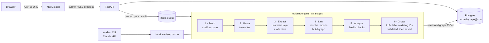

<div align="center">

# Evident

### Architecture maps you can verify.

**Point it at a repo. Get an interactive map of every route, database table and external service in your web app, and how they connect.
Every box and every arrow links to the exact line of code that proves it.**

[](https://github.com/aadilsal/Evident/actions/workflows/ci.yml)
[](LICENSE)


[**Status**](#status) · [**CLI**](#use-it-from-the-terminal) · [**Use with Claude**](#use-with-claude) · [**Benchmarks**](#accuracy-measured-not-promised) · [**How it works**](#how-it-works) · [**Docs**](docs/)

<!-- Swap for docs/assets/demo.gif: paste URL → map renders → click a route → request path lights up → evidence panel opens. -->


</div>

---

## The problem

You join a new codebase, or you're about to review a pull request in a project you don't know. The first question is always the same: **what talks to what?**

Which routes write to the `User` table? What breaks if I change `Invoice`? Where does Stripe get called? Is this endpoint behind auth?

Today's AI diagram tools answer with a picture of folders, drawn by an LLM guessing from the file tree. It looks convincing until you notice a component that doesn't exist. Coding agents have the same blind spot and fill it by guessing. **A diagram you can't verify is a diagram you can't trust.**

## The approach: facts first, AI second

Evident reads the code the way a compiler would. Static analysis with [tree-sitter](https://tree-sitter.github.io/) extracts the real routes, middleware, models, database calls, SDK imports and environment variables. Only then does an LLM step in, and its only job is to **group and label nodes that already exist**. Its output must reference real node IDs, and a validator rejects anything else.

The result is a map where nothing is made up, and you can check every claim.

<table>
<tr>
<td width="50%" valign="top">

### 🧾 Every edge has a receipt
Click any node or arrow to see the file, the line range and the highlighted snippet. A badge tells you whether it was **extracted** from code or **inferred** by grouping.

</td>
<td width="50%" valign="top">

### 🔦 Request tracer
Click a route and watch the path light up: **route → middleware → handler → service → model → table**, with the code for every hop in a side panel.

</td>
</tr>
<tr>
<td valign="top">

### 🩺 Architecture health checks
Findings with evidence, not lint noise:
*"`POST /api/users` writes to `User` with no auth middleware."* Plus unvalidated request bodies, circular imports, unused models and undocumented env vars.

</td>
<td valign="top">

### 💥 Blast radius
Select a table, file or env var and everything that depends on it is highlighted. It answers the real question: *what breaks if I change this?*

</td>
</tr>
<tr>
<td valign="top">

### 🤖 Built for agents too
One CLI, `evident`, with schema-valid `--json` on every command, plus a Claude skill that runs `impact` before it edits your models and cites `file:line` for every claim.

</td>
<td valign="top">

### 🗺️ A real, explorable graph
Not a static Mermaid image. A zoomable map built with React Flow and ELK auto-layout: filter by layer, collapse groups, follow a request end to end. Hosted, or local with `evident open`.

</td>
</tr>
</table>

## Status

Pre-alpha. **Phase 1 (Engine) is complete and Gate A is met.** Next up: Phase 2, the Claude skill. This table is updated at the end of every phase.

| Piece | State |
| --- | --- |
| Graph schema `1.1.0` + CLI output schema `1.1.0` | ✅ Done |
| JS/TS adapters: Next.js, Express, NestJS, Fastify, Prisma, Drizzle, TypeORM, Mongoose | ✅ Done, with fixture tests |
| Universal layer: module graph, SDK services, env vars, `docker-compose` containers, `tsconfig` aliases, workspaces | ✅ Done (JS/TS) |
| Stack detection + fallback map for unsupported stacks | ✅ Done |
| CLI: `analyze`, `trace`, `impact`, `find`, `health`, `show` with `--json` | ✅ Done |
| Health rules: unguarded write, unvalidated body, import cycle, unused model, undocumented env | ✅ Done |
| Benchmark: 5 repos labelled, `evident-bench`, CI gate (>2 pt drop fails) | ✅ Done |
| CI: pre-commit, mypy + pytest on Linux and Windows, benchmark gate | ✅ Done |
| Claude skill, `export`, `open`, `share` | ⏳ Phase 2 (week 4) |
| API, worker, Groq grouping, Python adapters | ⏳ Phase 3 |
| Web map UI, `/benchmarks` page, gallery | ⏳ Phase 4 |

## Accuracy, measured not promised

"It doesn't hallucinate" is a claim. Evident publishes a number instead.

A hand-labelled benchmark of **15–20 repos**, each pinned to a commit and covering every supported adapter, scores every engine change on precision and recall per category **and per adapter**. It will run in CI on every pull request and fail the build if any metric drops by more than 2 points.

| Category | Target precision | Target recall | Current |
| --- | :-: | :-: | :-: |
| Routes | ≥ 90% | ≥ 85% | **100% / 100%** (366 routes) |
| Models | ≥ 90% | ≥ 85% | **100% / 100%** (20 models) |
| Route → model read/write edges | ≥ 90% | ≥ 85% | **100% / 100%** (161 edges) |
| External services | tracked | tracked | **100% / 100%** (15 services) |

*Current* = precision / recall at Gate A (2026-11-10) on the first 5 repos (Next.js, Express, NestJS and Prisma), hallucination rate 0.3%. The labels were written from source by an AI assistant and are awaiting the owner's review, and these repos are fairly conventional. Expect the numbers to drop as the set grows to 15–20 repos with public open-source apps. Fastify, Drizzle, TypeORM and Mongoose have fixture tests but no labelled repos yet. Run it yourself: `cd engine && uv run evident-bench --verbose`.

The same repos are run through GitDiagram as a baseline, so the comparison is honest and reproducible. Method: [benchmark labelling guide](docs/labelling-guide.md). Results: the public `/benchmarks` page *(at launch)*.

## How it is different

| | Evident | GitDiagram | DeepWiki | CodeBoarding |
| --- | :-: | :-: | :-: | :-: |
| Source of truth | Static analysis | LLM over file tree | LLM-written wiki | LSP + LLM agents |
| Level of detail | Routes, handlers, tables, services | Folders and modules | Modules | Modules and components |
| Line-level evidence on every edge | ✅ | — | — | — |
| End-to-end request tracing | ✅ | — | — | — |
| Interactive graph | ✅ React Flow | Mermaid | Mermaid | Mermaid |
| Published accuracy score, per stack | ✅ | — | — | — |
| CLI + agent skill, fully offline | ✅ | — | — | ✅ |
| Language breadth | Per-framework adapters, each benchmarked | Any | Any | Many |

Evident doesn't compete on breadth. Each stack it supports gets a dedicated adapter and its own published score, so a map can be complete and every edge can be proven. Unsupported stacks still get the module and service map.

## Supported stacks

Adapters are tree-sitter queries plus a small mapper ([ADR-0006](docs/adr/0006-adapter-architecture.md)). Each one ships with fixtures, tests and benchmark cases.

| Ecosystem | Frameworks | ORMs | State |
| --- | --- | --- | --- |
| JS / TS | Next.js (App Router, server actions, middleware), Express, NestJS, Fastify | Prisma, Drizzle, TypeORM, Mongoose | ✅ v1 |
| Python | Django, FastAPI, Flask | Django ORM, SQLAlchemy | ⏳ v1 (Phase 3) |
| Any language | Universal layer: imports, SDK services, env vars, `docker-compose` containers | | ✅ JS/TS · ⏳ Python |
| Java/Kotlin · PHP · Ruby · C# · Go | Spring Boot, Laravel, Rails, ASP.NET Core, Gin/Echo/Chi | JPA, Eloquent, ActiveRecord, EF Core, GORM | After launch |

Plus `tsconfig` path aliases and npm/pnpm/yarn workspaces.

## Use it from the terminal

The engine is a standalone package (`pip install evident-map`, *not yet published*; for now, install from a clone). It's static and read-only: it never runs your code and writes only inside `.evident/`.

```bash
pip install -e engine          # from a clone, until the PyPI release
evident analyze .              # build or refresh .evident/graph.json
evident trace "POST /api/users"
evident impact User.email
evident find --writes Invoice
evident health --severity warning
evident show model:User
```

Every command takes `--json`, `--limit`, `--depth`, `--no-llm` and `--repo PATH|URL`. Exit codes: `0` ok · `1` findings or no match · `2` usage error · `3` analysis error. Coming in v1: `export`, `open` (local map UI, no Node needed) and `share` (opt-in, metadata only).

`uv run evident-bench` scores the engine against the labelled benchmark repos (cloned read-only at their pinned commits).

## Use with Claude

*Planned for week 4.* A Claude skill in `skills/evident/` drives the CLI for you. It runs `evident analyze --no-llm` once per session, runs `impact` before editing models or shared code, uses `trace` to explain flows and `health` on new routes, and never claims a dependency the tool didn't return.

## How it works



Five of the six stages are deterministic. The LLM stage can only label node IDs the engine already found, its output is validated before anything is saved, and `--no-llm` skips it entirely. Every graph conforms to a versioned [JSON Schema](schema/graph.schema.json), the single contract between the engine and every front-end.

**Safe by design:** Evident never runs the code it analyses. There's no `npm install`, no build and no scripts. Clones are shallow and size-capped, every job has a time limit, temp directories are wiped after each job, and every IP is rate limited. See the [threat model](docs/security.md).

## Quick start

> The hosted stack (`docker compose up`) arrives in Phase 3. Today, the engine CLI runs from a clone:

```bash
git clone https://github.com/aadilsal/Evident.git
cd Evident/engine
uv sync
uv run evident analyze /path/to/your/app
```

Working on the code instead? See [CONTRIBUTING.md](CONTRIBUTING.md).

## Tech stack

| Layer | Technology |
| --- | --- |
| Analysis engine + CLI | Python 3.12, tree-sitter (per-language grammars), custom import resolver, adapter registry |
| Agent integration | Claude skill (`skills/evident/`); MCP server in v2 |
| API | FastAPI, Server-Sent Events, auto-generated OpenAPI docs |
| Jobs | arq on Redis |
| Storage | Postgres (jobs, cached graphs, findings, benchmark history) |
| AI | Groq (free tier): one call per graph for grouping and labelling, validated against node IDs, auto-fallback to `--no-llm` |
| Frontend | Next.js, TypeScript, React Flow, ELK.js (also bundled into the pip package for `evident open`) |
| Infra | Docker Compose on a single VM, Caddy (automatic HTTPS), Cloudflare Tunnel |
| Quality | ruff, mypy, pytest, ESLint, Prettier, pre-commit, Conventional Commits, benchmark gate in CI (Linux + Windows) |

## Roadmap

- **v1 (launch):** engine + JS/TS and Python adapters, CLI, Claude skill, five views (system overview, route map, data model, request tracer, health findings), blast radius, live progress, featured gallery, PNG/SVG/Markdown/JSON exports, "report a wrong edge"
- **v1.5:** *Ask the map* (Q&A grounded in the graph, citing node IDs), commit time machine and diff, README embed, onboarding tour, Mermaid/C4/OpenAPI/SARIF exports
- **v2:** PR architecture bot (GitHub Action), MCP server, private repos / Pro tier
- **After launch:** Spring Boot → Laravel → Rails → ASP.NET Core → Go adapters

Full scope and rationale: [PRD](docs/PRD.md) · [Architecture](docs/architecture.md) · [Decision records](docs/adr/)

## Documentation

| Doc | What's in it |
| --- | --- |
| [PRD](docs/PRD.md) | Users, requirements, success metrics, milestones |
| [Architecture](docs/architecture.md) · [Essentials](docs/architecture-essentials.md) | Full system design · the one-page rules |
| [Graph schema](schema/) | The engine ↔ front-end contract |
| [DESIGN.md](DESIGN.md) | Visual design system: tokens, components, motion rules |
| [ADRs](docs/adr/) | Python + tree-sitter, React Flow, ID-only LLM, self-hosting, CLI-first, adapters, Groq |
| [Labelling guide](docs/labelling-guide.md) | How ground truth is counted |
| [Threat model](docs/security.md) · [Security policy](SECURITY.md) | Analysing untrusted repos safely; share-data rules |

## Contributing

Issues and PRs are welcome, and **"the map is wrong" reports are the most valuable kind**. Use the *Incorrect map* issue template with the repo URL and commit, and each one becomes a benchmark case. See [CONTRIBUTING.md](CONTRIBUTING.md).

## License

[MIT](LICENSE)
