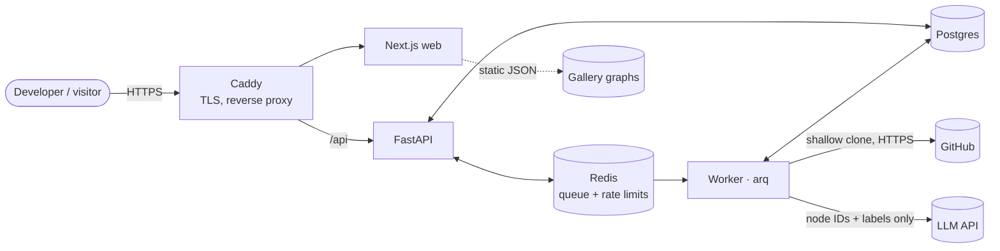
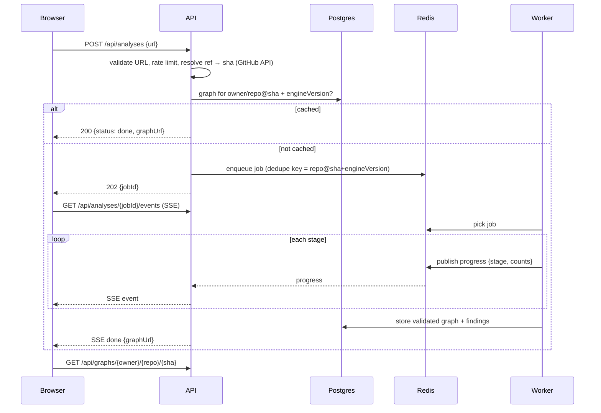

# Architecture

The full system design. For the one-page version, read [architecture-essentials.md](architecture-essentials.md). Decisions and their reasons live in [adr/](adr/).

## 1. System context



All services run as one Docker Compose stack on a single VM ([ADR-0004](adr/0004-self-host-on-a-vm.md)). Only the worker talks to GitHub and the LLM provider. Only Caddy is exposed.

## 2. Components

| Component | Responsibility | Tech |
| --- | --- | --- |
| **web** | Landing page, map UI (five views), evidence panel, gallery, `/benchmarks` | Next.js, TypeScript, React Flow, elkjs, anime.js, Tailwind (tokens from [DESIGN.md](../DESIGN.md)) |
| **api** | Validate submissions, cache lookup, enqueue, SSE progress, serve graphs | FastAPI, Pydantic |
| **worker** | Run the six-stage pipeline in a sandboxed temp dir | Python 3.12, arq, tree-sitter |
| **redis** | Job queue, job progress pub/sub, per-IP rate limits | Redis 7 |
| **postgres** | Jobs, cached graphs (JSONB), findings, benchmark history | Postgres 16 |
| **caddy** | Automatic HTTPS, routing, request size limits | Caddy 2 |

## 3. Request lifecycle



## 4. Worker pipeline

Five deterministic stages and one LLM stage. Each stage is a pure function from the previous stage's output (plus the read-only checkout), so stages are unit-testable in isolation.

| # | Stage | Input → output | Notes |
| --- | --- | --- | --- |
| 1 | **Fetch** | URL + sha → checkout in temp dir | `git clone --depth 1 --filter=blob:limit=1m --no-tags`, hooks disabled, no submodules, no LFS. Enforce size/file caps. See [threat-model.md](threat-model.md). |
| 2 | **Parse** | files → syntax trees | tree-sitter TS/TSX/JS grammars plus a small `schema.prisma` parser. Skip `node_modules`, build output, minified files, files > 1 MB. |
| 3 | **Extract** | trees → raw facts | Independent extractors: `next_routes`, `express_routes`, `prisma_schema`, `prisma_calls`, `services`, `env_vars`, `imports`. Each fact carries evidence. |
| 4 | **Link** | facts → graph | Resolve imports (tsconfig paths, workspaces), bind route → handler, follow call edges, track the Prisma client instance through re-exports, assign deterministic node IDs. Unresolvable links become `inferred` with lower confidence. |
| 5 | **Analyse** | graph → findings | Deterministic health rules: `unguarded-write`, `unvalidated-body`, `circular-import`, `unused-model`, `undocumented-env`. |
| 6 | **Group** | graph → groups | One LLM call with a compact node list (IDs, types, labels, paths; **no file contents**). The response is parsed and validated, and every member ID must exist. Invalid entries are dropped; if the call fails, a deterministic fallback groups by top-level directory. Then the full graph is validated against the JSON Schema and saved. |

Stages publish progress counts (`files parsed`, `routes found`) to Redis for SSE.

## 5. Graph data model

Defined in [schema/graph.schema.json](../schema/graph.schema.json) (JSON Schema 2020-12). Summary:

- **Nodes:** `route`, `handler`, `function`, `middleware`, `model`, `service`, `module`, `envVar`
- **Edges:** `handles` (route → handler), `guards` (middleware → route), `calls`, `imports`, `reads` (fn → model | envVar), `writes` (fn → model), `relates` (model → model), `uses` (fn | module → service)
- **Every node and edge:** `evidence[]` (≥ 1 item: `file`, `startLine`, `endLine`, `sha`), `source` (`extracted` | `inferred`), `confidence` (0–1)
- **groups[]:** LLM output, always `inferred`, members are existing node IDs
- **findings[]:** health-check results with evidence
- **Node IDs** are deterministic: `<type>:<natural key>`, e.g. `route:POST /api/invoices`, `handler:app/api/invoices/route.ts#POST`, `model:Invoice`, `envVar:STRIPE_SECRET_KEY`

The schema checks shape. The engine's validator also checks referential integrity (edge endpoints, group members and finding node IDs all exist) and `endLine ≥ startLine`.

**Versioning:** `schemaVersion` is semver. A minor version is additive; the frontend ignores unknown optional fields. A major version is breaking and needs a frontend release in the same PR. `engineVersion` bumps on any extractor change and is part of the cache key, so a better engine re-analyses automatically.

## 6. API (v1)

FastAPI serves OpenAPI at `/api/docs`; each endpoint gets a one-line description in code.

| Method | Path | Purpose |
| --- | --- | --- |
| `POST` | `/api/analyses` | Submit `{url}`; returns `200` with cached `graphUrl` or `202 {jobId}` |
| `GET` | `/api/analyses/{jobId}` | Job status snapshot |
| `GET` | `/api/analyses/{jobId}/events` | SSE progress stream |
| `GET` | `/api/graphs/{owner}/{repo}/{sha}` | Graph JSON (immutable, long cache headers) |
| `GET` | `/api/gallery` | Featured repos with graph URLs |
| `GET` | `/api/benchmarks` | Latest and historical benchmark results |
| `GET` | `/api/health` | Liveness for the uptime monitor |

## 7. Storage

| Table | Key | Contents |
| --- | --- | --- |
| `jobs` | `id` | repo, sha, engine_version, status, stage, error, timings, client IP hash |
| `graphs` | `(owner, repo, sha, engine_version)` | `graph` JSONB, node/edge counts, created_at |
| `findings` | `graph_id, finding_id` | Denormalised for querying across repos |
| `benchmark_runs` | `id` | git sha of Evident, per-repo per-category P/R/F1, cost, duration |

The gallery is exported to static JSON in `web/public/gallery/` at build time, so it survives an API outage.

## 8. Frontend

- **Data flow:** fetch graph JSON → validate `schemaVersion` major → build indexes (by ID, adjacency in/out) → derive views (overview, routes, ERD, trace, findings) as pure selectors.
- **Layout:** elkjs `layered` algorithm with orthogonal routing, run in a Web Worker and cached per view.
- **Trace and blast radius** are graph traversals over the adjacency index (BFS forward for traces, reverse for blast radius) with no server round-trip.
- **Permalinks:** `/{owner}/{repo}/{sha}?view=trace&node=<id>&layers=route,model` holds all state in the URL.
- **Design system:** [DESIGN.md](../DESIGN.md). Tokens are exported to Tailwind v4, and anime.js handles trace choreography.

## 9. Repository layout

```
.
├── engine/                 Python: api, worker, extractors, linker, analysers, llm, bench
│   ├── src/evident/
│   └── tests/fixtures/     tiny TS/JS/Prisma snippets with expected graphs
├── web/                    Next.js frontend
├── schema/                 graph.schema.json + examples (the contract)
├── benchmark/ground-truth/ hand-labelled YAML per repo
├── deploy/                 docker-compose.yml, Caddyfile (added with infra)
├── docs/                   design doc, PRD, architecture, ADRs, threat model, guides
└── .github/                CI, issue/PR templates
```

## 10. Observability

- Structured JSON logs (job id, stage, duration) from api and worker
- Per-job timings and LLM token usage stored on `jobs` and summed for a cost dashboard query
- External uptime monitor on `/api/health` and the landing page
