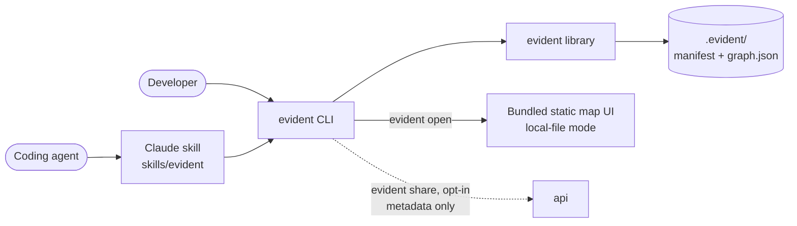
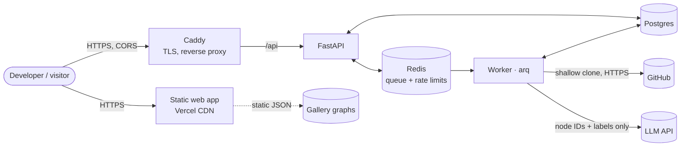
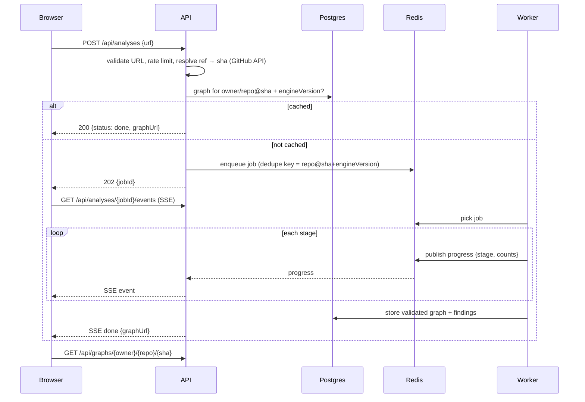

# Architecture

The full system design. For the one-page version, read [architecture-essentials.md](architecture-essentials.md). Decisions and their reasons live in [adr/](adr/).

## 1. System context

The engine is a standalone pip package (`evident-map`) with a CLI. Everything below is the **hosted** deployment. The same library also runs locally through the CLI and the Claude skill, offline, writing only to `.evident/` ([ADR-0005](adr/0005-cli-first-three-front-ends.md)):



Hosted:



The web app is a static export served from Vercel; the browser calls the API cross-origin and loads code snippets from GitHub at the pinned commit ([ADR-0008](adr/0008-static-web-on-vercel-api-on-one-server.md)). The backend runs as one Docker Compose stack on a single server ([ADR-0004](adr/0004-self-host-on-a-vm.md)). Only the worker talks to GitHub and the LLM provider. Only Caddy is exposed.

## 2. Components

| Component | Responsibility | Tech |
| --- | --- | --- |
| **engine / CLI** | `evident-map` package: stack detection, universal layer, adapters, linker, health checks, queries, `.evident/` cache, CLI | Python 3.12, tree-sitter, argparse |
| **skill** | Claude skill that drives the CLI for coding agents | `skills/evident/SKILL.md` + scripts |
| **web** | Landing page, map UI (five views), evidence panel, gallery, `/benchmarks`, supported-stacks page, report page; static export on Vercel, also bundled into the pip package for `evident open` | Next.js (static export), TypeScript, React Flow, elkjs, anime.js, Shiki, Tailwind (tokens generated from [DESIGN.md](../DESIGN.md)) |
| **api** | Validate submissions, cache lookup, enqueue, SSE progress, serve graphs | FastAPI, Pydantic |
| **worker** | Run the six-stage pipeline in a sandboxed temp dir | Python 3.12, arq, tree-sitter |
| **redis** | Job queue, job progress pub/sub, per-IP rate limits | Redis 7 |
| **postgres** | Jobs, cached graphs (JSONB), findings, benchmark history | Postgres 16 |
| **caddy** | Automatic HTTPS for `api.<domain>`, request size limits | Caddy 2 |

## 3. Request lifecycle



## 4. Worker pipeline

Five deterministic stages and one LLM stage. Each stage is a pure function from the previous stage's output (plus the read-only checkout), so stages are unit-testable in isolation.

| # | Stage | Input → output | Notes |
| --- | --- | --- | --- |
| 1 | **Fetch** | URL + sha → checkout in temp dir | `git clone --depth 1 --filter=blob:limit=1m --no-tags`, hooks disabled, no submodules, no LFS. Enforce size/file caps. See [security.md](security.md). |
| 2 | **Parse** | files → syntax trees | tree-sitter grammars per detected language (TS/TSX/JS, Python, …) plus a small `schema.prisma` parser. Skip `node_modules`, build output, minified files, files > 1 MB. |
| 3 | **Extract** | trees → raw facts | Stack detection from manifests picks adapters ([ADR-0006](adr/0006-adapter-architecture.md)). The **universal layer** (imports, services, env vars, `docker-compose` containers) always runs; **adapters** (tree-sitter `.scm` queries + a Python mapper, e.g. `nextjs`, `express`, `nestjs`, `fastify`, `prisma`, `drizzle`, `typeorm`, `mongoose`, `django`, `fastapi`, `flask`, `django-orm`, `sqlalchemy`) add routes, middleware and models. No matching adapter → universal map + an "unsupported framework" message. Each fact carries evidence. |
| 4 | **Link** | facts → graph | Resolve imports (tsconfig paths, workspaces), bind route → handler, follow call edges, track the Prisma client instance through re-exports, assign deterministic node IDs. Unresolvable links become `inferred` with lower confidence. |
| 5 | **Analyse** | graph → findings | Deterministic health rules: `unguarded-write`, `unvalidated-body`, `circular-import`, `unused-model`, `undocumented-env`. |
| 6 | **Group** | graph → groups | Skipped with `--no-llm`. One LLM call (Groq free tier, [ADR-0007](adr/0007-groq-for-llm-grouping.md); lines of `key|type|label|path`, most useful types first, interleaved across directories, cut to a size budget) with a compact node list (IDs, types, labels, paths; **no file contents**). The response is parsed and validated, and every member ID must exist. Invalid entries are dropped; if the call fails, is rate-limited or over quota, a deterministic fallback groups by top-level directory and the result reports `llm: unavailable`. Then the full graph is validated against the JSON Schema and saved. |

Stages publish progress counts (`files parsed`, `routes found`) to Redis for SSE.

**Worker execution (as of Phase 3).** arq runs one job per worker process. Each job spawns a child process for the whole pipeline, relays its progress events to Redis and Postgres, and kills it at `EVIDENT_JOB_TIMEOUT_S`, because a thread can't be killed. The child's per-job temp dir is removed in `finally`, and a cron sweeper removes orphans older than 10 minutes. LLM groups are exclusive (one group per node). Nodes the prompt didn't include join the group of a member from the same file, then of their directory, and any rest fall into directory groups.

**How the engine is built (as of Phase 1).** Extract is two layers. `universal/js.py` summarises each file into cacheable JSON: imports, exports, CommonJS bindings, function scopes with their calls, locals, params and env reads, classes with decorators and typed fields, and request-body reads. Each adapter adds its own per-file facts (e.g. Express route calls via a `.scm` query). Link (`link.py`) resolves specifiers (relative, tsconfig paths, workspaces), symbols (through re-exports) and package taint (`const db = new PrismaClient()`). Adapters then mark handlers and middleware and register **call classifiers** for their ORM. `universal/build.py` builds the function graph as the call closure of every handler and middleware, applying the classifiers to every call. Function IDs are placeholders until roles are final (handler > middleware > function).

## 5. Graph data model

Defined in [schema/graph.schema.json](../schema/graph.schema.json) (JSON Schema 2020-12). Summary:

- **Nodes:** `route`, `handler`, `function`, `middleware`, `model`, `service`, `module`, `envVar`; `container` (from `docker-compose.yml`) is planned for schema `1.1.0`, and `framework` enums grow as adapters land
- **Edges:** `handles` (route → handler), `guards` (middleware → route), `calls`, `imports`, `reads` (fn → model | envVar), `writes` (fn → model), `relates` (model → model), `uses` (fn | module → service)
- **Every node and edge:** `evidence[]` (≥ 1 item: `file`, `startLine`, `endLine`, `sha`), `source` (`extracted` | `inferred`), `confidence` (0–1)
- **groups[]:** LLM output, always `inferred`, members are existing node IDs
- **findings[]:** health-check results with evidence
- **Node IDs** are deterministic: `<type>:<natural key>`, e.g. `route:POST /api/invoices`, `handler:app/api/invoices/route.ts#POST`, `model:Invoice`, `envVar:STRIPE_SECRET_KEY`

The schema checks shape. The engine's validator also checks referential integrity (edge endpoints, group members and finding node IDs all exist) and `endLine ≥ startLine`.

**Versioning:** `schemaVersion` is semver. A minor version is additive; the frontend ignores unknown optional fields. A major version is breaking and needs a frontend release in the same PR. `engineVersion` bumps on any extractor change and is part of the cache key, so a better engine re-analyses automatically.

## 6. API (v1)

FastAPI serves OpenAPI at `/api/docs`; each endpoint gets a one-line description in code.

| Method | Path | Purpose |
| --- | --- | --- |
| `POST` | `/api/analyses` | Submit `{url}`; returns `200` with cached `graphUrl` or `202 {jobId}` |
| `GET` | `/api/analyses/{jobId}` | Job status snapshot |
| `GET` | `/api/analyses/{jobId}/events` | SSE progress stream |
| `GET` | `/api/graphs/{owner}/{repo}/{sha}` | Graph JSON (immutable, long cache headers) |
| `GET` | `/api/gallery` | Featured repos with graph URLs |
| `GET` | `/api/benchmarks` | Latest and historical benchmark results |
| `POST` | `/api/shares` | `evident share` upload: schema-validated, size-capped graph metadata; returns an expiring link and a delete token |
| `GET` | `/api/shares/{id}` | A shared graph until it expires |
| `DELETE` | `/api/shares/{id}` | Delete early (`X-Delete-Token`) |
| `POST` | `/api/reports` | "Report a wrong node/edge" from the map |
| `GET` | `/api/health` | Liveness for the uptime monitor |

CORS allows only the origins in `EVIDENT_CORS_ORIGINS` (the site), with no credentials.

## 7. Storage

| Table | Key | Contents |
| --- | --- | --- |
| `jobs` | `id` | repo, sha, engine_version, status, stage, error, timings, client IP hash |
| `graphs` | `(owner, repo, sha, engine_version)` | `graph` JSONB, node/edge counts, created_at |
| `findings` | `graph_id, finding_id` | Denormalised for querying across repos |
| `benchmark_runs` | `id` | git sha of Evident, per-repo per-category P/R/F1, cost, duration |
| `shares` | `id` | validated graph JSONB, hashed delete token, IP hash, expiry |
| `reports` | `id` | repo, sha, engine version, element id, kind, note, IP hash |

The gallery is pre-analysed into static JSON in `web/public/data/gallery/` (`engine/scripts/build_gallery.py`), and benchmark results are copied in at build time, so both survive an API outage.

## 8. Frontend

- **Static export** (`output: "export"`, [ADR-0008](adr/0008-static-web-on-vercel-api-on-one-server.md)): one build serves Vercel and `evident open`.
- **Data source switch** (`web/src/lib/source.ts`): the hosted API (`?repo=&sha=`), the static gallery (`?gallery=`), `evident open` (`?local=1`, served from `/local/graph.json`), or a share link (`?share=`). Snippets come from `raw.githubusercontent.com` at the pinned SHA for GitHub graphs and from `/local/file` (allowlisted to cited files) for local ones; shared local graphs have none.
- **Data flow:** fetch graph JSON → check the `schemaVersion` major → build indexes (by ID, adjacency in/out) → derive views as pure functions (`web/src/lib/views.ts`): overview (groups collapsed, one line per pair), route map (routes → models/services reached through handlers), data model, trace, blast radius, focus (findings).
- **Layout:** elkjs `layered` with orthogonal routing in a Web Worker (`/elk-worker.min.js`, main-thread fallback); edges are drawn along ELK's routes with 6px corners.
- **Trace and blast radius** are the engine's BFS ported to TypeScript (`web/src/lib/graph.ts`); Vitest checks them against goldens generated by the engine (`engine/tests/test_web_contract.py`).
- **Permalinks:** `/map/?repo=owner/name&sha=…&view=trace&root=<id>&node=<id>&hide=env&open=group:x` holds all state in the URL.
- **Types** are generated from the schema (`npm run gen:types`); **tokens** from DESIGN.md (`npm run tokens`). CI fails if either is stale.
- **Design system:** [DESIGN.md](../DESIGN.md); anime.js draws the trace hop by hop and counts up progress.

## 9. Repository layout

```
.
├── engine/                 Python package evident-map: CLI, engine, api, worker, llm, bench
│   ├── src/evident/        cli, analyze, cache, query, health, repo, link, pipeline, bench, universal/, adapters/<name>/
│   └── tests/fixtures/     tiny per-adapter snippets with expected graphs
├── skills/evident/         Claude skill: SKILL.md, scripts/ensure_installed.sh
├── skill-tasks/            agent tasks run with vs without the skill
├── web/                    Next.js static export: app/ (pages), components/map/, lib/ (graph, views, layout, url, source)
├── schema/                 graph.schema.json + examples (the contract)
├── benchmark/              repos.yaml (pinned SHAs), ground-truth/ (labelled YAML), results/baseline.json (CI gate)
├── deploy/                 docker-compose.yml (Caddyfile added at launch)
├── docs/                   design doc, PRD, architecture, ADRs, threat model, guides
└── .github/                CI, issue/PR templates
```

## 10. Observability

- Structured JSON logs (job id, stage, duration) from api and worker
- Per-job timings and LLM token usage stored on `jobs` and summed for a cost dashboard query
- External uptime monitor on `/api/health` and the landing page
